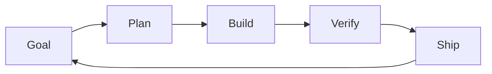

<div align="center">


Essential skills for the full lifecycle of an AI agent, in one place — from goal to shipped.

[](https://www.npmjs.com/package/galyarder-framework)
[](LICENSE)
[](https://github.com/galyarderlabs/galyarder-framework)
[](https://github.com/galyarderlabs/galyarder-framework/actions/workflows/smoke-test.yml)

[](https://github.com/sponsors/galyarderlabs)

Using an AI agent shouldn't be just generating code, and the agent shouldn't be confused. It is not a kanban board, a prompt pack, or another AI agent. This is the right way to work: rules and a workflow, simple as that. The best skills, unified in one place — in your company, and in your life.

</div>

## How it works



1. **Goal** — say what you want, in plain words.
2. **Plan** — the work is routed to the right department and planned.
3. **Build** — the agent does the work, with tests before anything ships.
4. **Verify** — every claim is checked against evidence before it counts.
5. **Ship** — the work goes out. Distribution is where the loop ends.

The full workflow, with the five phases in detail, is in [docs/WORKFLOW.md](docs/WORKFLOW.md).

## Rules

- Human-directed: public, financial, and production actions need a human's approval.
- Evidence before completion: no claim counts without proof you can check.
- Tests before fixes: nothing ships unverified.
- Ship it: the loop ends at distribution, not at a draft.

## Install

```sh
npm install -g galyarder-framework
```

Or pull just the skills you need:

```sh
npx skills add galyarderlabs/galyarder-framework --skill full
```

Step by step, including local install and other tools, is in [docs/QUICK_START.md](docs/QUICK_START.md).

## Documentation

- [Quick start](docs/QUICK_START.md) — install and first run
- [Workflow](docs/WORKFLOW.md) — the five phases, in full
- [Integration](docs/INTEGRATION.md) — the tools it plugs into
- [Codex guide](docs/README.codex.md) — using it with OpenAI Codex
- [OpenCode guide](docs/README.opencode.md) — using it with OpenCode
- [Departments](docs/departments/) — the departments and what each owns
- [Agents](docs/agents/) — the personas that do the work
- [Skills](docs/skills/) — the full skill list
- [Commands](docs/commands/) — the shortcuts
- [Roadmap](ROADMAP.md) — what we are building next
- [Changelog](CHANGELOG.md) — what changed

## Contributing

Bug reports, ideas and pull requests are welcome. See
[CONTRIBUTING.md](CONTRIBUTING.md) for how to build, test and send changes,
and [CHANGELOG.md](CHANGELOG.md) for what changed. Everyone taking part
follows the [Code of Conduct](CODE_OF_CONDUCT.md); please report security
problems privately as described in [SECURITY.md](SECURITY.md).

## Support

Galyarder Framework is free and always will be. If it makes your agents work the right way, you can [sponsor Galyarder Labs on GitHub](https://github.com/sponsors/galyarderlabs). A star, a bug report or telling a friend helps just as much.

## Star History

[](https://star-history.com/#galyarderlabs/galyarder-framework&Date)

## License

MIT. See [LICENSE](LICENSE).

---

<div align="center">

[](https://github.com/galyarderlabs/galyarder-framework)

</div>
