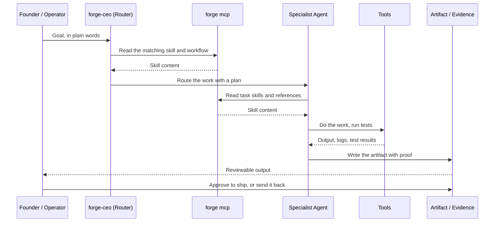

# Forge Anything Workflow

The workflow turns ideas into reviewed, shipped, earned-from work, and back into values. The flow is Ideas, Goal, Ship, Earn, Give back; the goal-to-ship loop inside it is Goal, Plan, Build, Verify, Ship, and it ends at distribution. Coding is one
surface; the workflow covers the whole company and life, not just code.

## How the pieces fit

The agent gets the workflow two ways. Through a harness plugin, the
skills, agents, and commands are installed into the harness the agent
already uses (Claude Code, OMP/Pi, Codex, Cursor, Antigravity, OpenCode,
Copilot CLI, Hermes; see `docs/INTEGRATION.md`). Through the MCP, any
agent or chatbot that can add an MCP server gets the tools plus the
workflow: `forge mcp` exposes `list_skills`, `read_skill`, `read_agent`,
`read_command`, and `scaffold` over stdio, local only, no network. The
scaffold (`forge scaffold`) drops a tidy repo that already follows this
workflow.

## Operational sequence

The sequence below shows who talks to whom, in order, across the five
phases. The operator sets the goal, `forge-ceo` routes it, the specialist
executes through tools, and the result returns as reviewable evidence.

---

## Foundation Protocols

Every workflow should keep these operating constraints visible:

1. **Traceability**: work maps to a scoped issue, brief, plan, decision, report, or PR.
2. **Grounding**: agents inspect the repo, source docs, user context, and relevant APIs before acting.
3. **Routing**: work moves to the correct department, agent, skill, command, or tool path.
4. **Planning**: non-trivial work gets a blueprint with constraints, risks, success criteria, and proof gates.
5. **Verification**: completion claims require tests, builds, reviews, citations, screenshots, logs, workflow runs, or other evidence.
6. **Persistence**: useful results become durable artifacts: docs, reports, release notes, campaigns, financial models, decision logs, or reusable skills.
7. **Human approval**: public, external, financial, irreversible, access, or production-sensitive actions require the operator's approval.

---

## Operational Modes

| Mode | Use case | Rules |
| :--- | :--- | :--- |
| **BUILD** | Normal product, docs, growth, finance, or engineering work | Use planning, implementation, review, and verification gates. |
| **INCIDENT** | Urgent breakage or production risk | Move faster, document the incident, and create follow-up cleanup work. |
| **EXPERIMENT** | Timeboxed exploration or prototype | Keep it reversible, mark assumptions, and avoid merging throwaway work into stable paths. |

---

## Verification Ladder

Use the cheapest proof that actually verifies the claim.

1. **Logic-level checks**: unit tests, schema validation, lint, typecheck, calculations, or static scans.
2. **Interface checks**: API contracts, CLI output, generated files, markdown/docs rendering, or tool-response shape.
3. **System checks**: smoke tests, browser tests, workflow runs, deploy checks, or live artifact verification.
4. **Human review gates**: approval for public posts, external sends, security changes, production deploys, account access, and irreversible actions.

---

## Phase 1: Goal

**Typical owners:** `forge-ceo`, `forge-cmo`, `product-manager`, `growth-strategist`

**Common skills:** `brainstorming`, `prd-flow`, `marketing-core`, `market-research`, `founder-context`

1. Clarify the operator's goal and the real outcome.
2. Identify the buyer, user, stakeholder, system, or workflow affected.
3. Define success criteria, constraints, assumptions, risks, and kill conditions.
4. Create a PRD, issue, planning note, or short execution brief when needed.

## Phase 2: Plan

**Typical owners:** `forge-cto`, `super-architect`, `architect`, `planner`

**Common skills:** `prd-flow`, `writing-plans`, `ubiquitous-language`

1. Inspect the current codebase, docs, data, or workflow surface.
2. Pull current official references for APIs and platform behavior.
3. Choose the smallest viable implementation path.
4. Break work into vertical slices or domain-specific deliverables.
5. Write decisions as ADRs, plans, or reviewable notes when the tradeoff matters.

## Phase 3: Build

**Typical owners:** `elite-developer`, `ui-ux-designer`, `security-guardian`, `legal-counsel`, `growth-engineer`

**Common skills:** `subagent-driven-development`, `test-driven-development`, `systematic-debugging`, `marketing-core`, `accounting-core`, `legal-tos-privacy`

1. Move the active issue, brief, or task into progress.
2. Execute through the correct specialist, command, tool, or subagent.
3. Keep changes scoped to the outcome.
4. Preserve useful technical content instead of replacing it with generic messaging.
5. Leave enough context for another maintainer to inspect the result.

## Phase 4: Verify

**Typical owners:** `qa-automation-engineer`, `code-reviewer`, `security-reviewer`, `devops-engineer`, `legal-counsel`, `forge-cfo-coo`

**Common skills:** `adversarial-review`, `verification-before-completion`, `gdpr-ccpa-privacy-auditor`

1. Run the relevant test, build, lint, render, security, or source-verification checks.
2. Review for overreach, unsafe automation, secrets, fragile assumptions, and unverified claims.
3. Confirm external/public actions are approved before sending, posting, inviting, deploying, or changing access.
4. Record evidence and blockers instead of hiding uncertainty.

## Phase 5: Ship

**Typical owners:** `forge-cmo`, `social-strategist`, `release-manager`, `obsidian-architect`

**Common skills:** `seo-audit`, `marketing-core`, `release`, `doc-maintenance`, `obsidian-markdown`

1. Prepare release notes, documentation, launch copy, or a distribution plan when the work is meant to ship.
2. Save reusable knowledge into docs, skills, decisions, or reports.
3. Update the issue/task state and name the evidence used.
4. Hand the final decision back to the operator when public, external, financial, or irreversible action is involved.

---

## Phase 6: Earn

**Typical owners:** `finops-manager` (plus `trading-quant`, `trading-discipline`, `accounting-ops` once their agent folders land)

**Common skills:** `finance-based-pricing-advisor`, `saas-finops-optimization`, `payments-core`, `quant-trading`, `invoice-lifecycle`

1. Price the work: cost, value, and the price the market bears.
2. Collect payment through the real payment path, with an invoice for every charge.
3. Reconcile what came in against what was expected; name every gap.
4. Track runway and ROI so the operator knows what the work earned.

---

## Phase 7: Give back

**Typical owners:** the operator

**Common skills:** `journal-framework`, `reflective-listening`, `faith-practice`, `personal-finance`

1. Name what was earned, in plain words, before anything is returned.
2. Return from it: share, teach, or contribute what the work proved.
3. Record the values behind the return, not just the act.
4. Check the uncomfortable facts behind finance and politics before claiming to understand them.

**Core rule:** do not call work complete until the relevant artifact exists and the verification path has been exercised.
